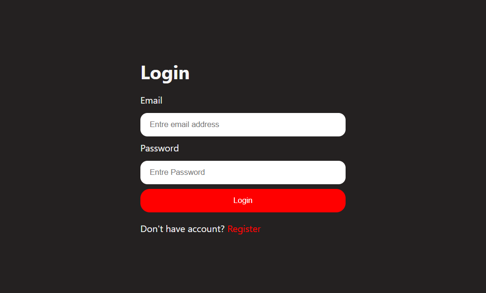

# GenAI Interview Plan

AI-powered interview preparation platform that helps candidates analyze a job description and their profile, then generate a personalized interview strategy, skill-gap insights, and a study roadmap.

## Overview

This project combines a React frontend with a Node.js/Express backend and integrates with Google Gemini AI to create:

- a candidate-to-job match score
- technical and behavioral interview questions
- skill gap analysis
- a 7-day preparation plan
- a tailored interview strategy based on resume and profile data

## Features

- User authentication and authorization
- Resume upload support
- Self-description form input
- Job description input
- AI-generated interview report
- Preparation roadmap
- Match score and skill gap tracking

## Tech Stack

### Frontend

- React
- Vite
- React Router
- SCSS

### Backend

- Node.js
- Express
- MongoDB with Mongoose
- JWT authentication
- Google GenAI

## Project Structure

```bash
GenAI-interview-plan/
├── Backend/
│   ├── src/
│   ├── .env.example
│   ├── package.json
│   └── server.js
├── Frontend/
│   ├── src/
│   ├── index.html
│   └── package.json
├── README.md
├── .gitignore
└── .env.example
```

## Screenshots



## Setup

1. Clone the repository
2. Install dependencies for both apps

```bash
cd Backend
npm install

cd ../Frontend
npm install
```

3. Create your local environment file from the example

```bash
cp .env.example .env
```

4. Update the values in `.env` with your local configuration.

5. Run the application

```bash
cd Backend
npm run dev
```

```bash
cd Frontend
npm run dev -- --host 0.0.0.0
```

## Environment Variables

Create a `.env` file in the `Backend` folder with values like:

```env
PORT=5000
MONGO_URI=mongodb://localhost:27017/genai-interview-plan
JWT_SECRET=your_jwt_secret_here
GOOGLE_GENAI_API_KEY=your_google_genai_api_key_here
```

> Keep your `.env` file local and do not commit it to GitHub.

## Current Status

This is an early-stage project and is being pushed to GitHub as a working progress snapshot.

## License

This project is currently for personal and learning use.
